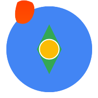

<p align="center">
  <a href="https://skyt-a.github.io/svelte-google-maps-api/">
    
  </a>
  <h1 align="center">
   Svelte Google Maps API
  </h1>
</p>

[](https://badge.fury.io/js/svelte-google-maps-api)
[](https://opensource.org/licenses/MIT)

Svelte 5 components for the Google Maps JavaScript API, built on Advanced Markers, Places API (New) and the Routes library.

## Links

- Documentation: https://skyt-a.github.io/svelte-google-maps-api/
- Storybook: https://skyt-a.github.io/svelte-google-maps-api/storybook/
- npm: https://www.npmjs.com/package/svelte-google-maps-api

## Installation

```bash
pnpm add svelte-google-maps-api
# or
npm install svelte-google-maps-api
```

Requires Svelte 5.

## Quick Start

```svelte
<script lang="ts">
	import { APIProvider, GoogleMap, AdvancedMarker } from 'svelte-google-maps-api';

	const apiKey = 'YOUR_API_KEY';
	let center = $state({ lat: 35.6812362, lng: 139.7649361 });
	let zoom = $state(14);
</script>

<div style="width: 100%; height: 100vh;">
	<APIProvider {apiKey}>
		<GoogleMap bind:center bind:zoom mapId="DEMO_MAP_ID">
			<AdvancedMarker position={{ lat: 35.6812362, lng: 139.7649361 }} title="Tokyo Station" />
		</GoogleMap>
	</APIProvider>
</div>
```

`AdvancedMarker`, `Pin`, `MarkerClusterer` and `RouteRenderer` markers need a map with a `mapId`. `DEMO_MAP_ID` works for development. Components load the Google Maps libraries they need on demand.

## Components

`APIProvider`, `GoogleMap`, `AdvancedMarker`, `Pin`, `MarkerClusterer`, `InfoWindow`, `Polyline`, `Polygon`, `Circle`, `Rectangle`, `GroundOverlay`, `Data`, `TrafficLayer`, `TransitLayer`, `BicyclingLayer`, `MapControl`, `OverlayView`, `PlaceAutocomplete`, `RouteRenderer` and `StreetViewPanorama`, plus the `useMap`, `useMapsLibrary` and `useAPILoadingStatus` helpers.

See the [package README](packages/svelte-google-maps-api/README.md) and the docs for props and examples.

## Upgrading from 0.2

0.3 is a rewrite on Svelte 5 runes. It removes the components that wrapped deprecated or discontinued Google Maps APIs: `Marker`, `DrawingManager`, `HeatmapLayer`, `KmlLayer`, `Autocomplete`, `StandaloneSearchBox` and the Directions / Distance Matrix services. See the [migration guide](https://skyt-a.github.io/svelte-google-maps-api/guide/migration/).

## Development

```bash
corepack pnpm install
corepack pnpm test
corepack pnpm check
corepack pnpm lint
corepack pnpm build
```

Docs and Storybook stay synchronized with the package exports:

```bash
corepack pnpm docs:sync:check
```

## Contributing

See [CONTRIBUTING.md](CONTRIBUTING.md).

## Security

See [SECURITY.md](SECURITY.md).

## License

MIT
